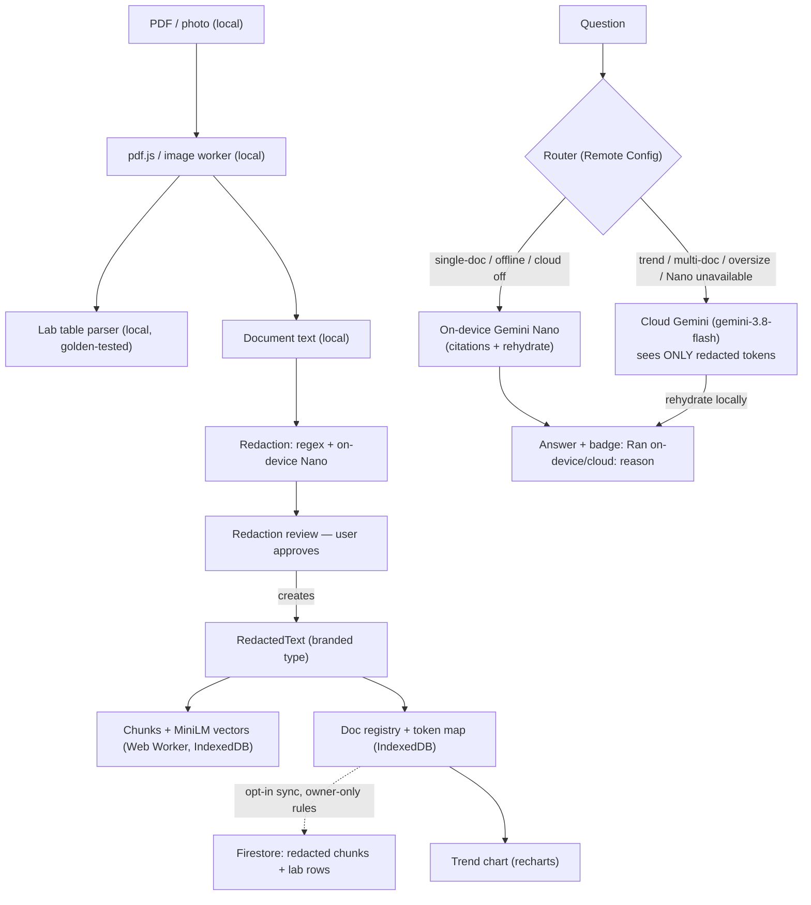

# SafeDocs

**Privacy-first web app (Chrome) that helps patients understand their medical
records.** Built for Google's **#BuildHybridAI** hackathon (Firebase AI Logic
hybrid inference).

## The problem

Lab reports and discharge summaries are written for clinicians: dense tables,
cryptic abbreviations, reference ranges, flags. Most patients Google their
results — pasting full reports (names, MRNs, dates of birth) into random
websites and chatbots. SafeDocs makes the report understandable **without the
record ever leaving the patient's computer**.

## Value proposition

- **Understand**: parsed lab tables with H/L flagging, plain-language Q&A with
  citations, per-value explanations, "questions for my doctor", and a
  whole-document summary.
- **Track**: trends across visits (chart) and cross-document questions.
- **Stay private**: on-device AI does everything sensitive. Raw text and
  images **never** leave the computer; the cloud only ever sees redacted
  tokens — and only after you approve and opt in.

## How Firebase AI Logic hybrid inference is used

| Capability | Where | Code pointer |
| --- | --- | --- |
| Hybrid Q&A model (`PREFER_ON_DEVICE`, cloud fallback) | understanding docs | `src/ai/hybrid.ts` (`generate`) |
| `ONLY_ON_DEVICE` for anything possibly PII (redaction layer 2, OCR vision, all F6 intelligence) | redaction, OCR, Q&A, summaries | `src/ai/hybrid.ts` (`generateOnDevice`), `src/intelligence/*` |
| Multimodal on-device (inline image part) | photo OCR | `src/ai/hybrid.ts` + `src/ocr/*` |
| Cloud, gated by the branded `RedactedText` choke point | cross-doc / trend Q&A | `src/ai/cloud.ts` (`sendToCloud`), `src/ai/hybridAsk.ts` |
| Remote Config (`local_max_tokens`, `cloud_enabled`, `min_confidence`) | routing | `src/ai/routerConfig.ts`, `src/firebase.ts` |
| App Check (reCAPTCHA Enterprise) | every backend call | `src/firebase.ts` |
| Firestore (owner-only rules) | opt-in sync of redacted chunks + lab rows | `src/sync/firestoreSync.ts`, `firestore.rules` |

## Architecture



## Routing rules

| Condition | Runs where | Why |
| --- | --- | --- |
| Offline | On-device (+ "limited" note) | No network; privacy unaffected |
| `cloud_enabled` false | On-device | Cloud is an explicit opt-in |
| On-device AI unavailable | Cloud | Nano missing in this browser |
| Trend-shaped question ("over time", "compare") | Cloud | Cross-visit analysis |
| Question spans several documents | Cloud | Cross-doc context |
| Retrieved context > `local_max_tokens` | Cloud | Too much context for Nano |
| Everything else | On-device | Default: nothing leaves the computer |

**Privacy guarantees**

1. Raw text or images never reach the cloud — the only cloud entry point is
   `sendToCloud(redacted: RedactedText)`, a branded type only the redaction
   module can create (compile-time `unique symbol` + runtime token, both
   guard-tested).
2. The token map (`[NAME_1] → real value`), original files, and embeddings
   live in IndexedDB and never sync.
3. Firestore (opt-in) stores redacted chunks + structured lab rows only,
   under owner-only security rules; payload shape is guard-tested.
4. Cloud answers are rehydrated locally, so the user reads real names but the
   cloud never learned them.
5. Every answer is informational, never a diagnosis, carries a
   "not medical advice" disclaimer, and cites `[doc, page]` sources.

## Lab table extraction accuracy

12 synthetic lab-report fixtures (`tests/fixtures/labs/`, generated by
`npm run gen:fixtures`) run through real pdf.js extraction → row grouping →
`src/labs/parseRows.ts`, compared field by field against hand-authored
expectations (`tests/labs/golden.test.ts` prints this table):

```
Lab extraction accuracy — real pdf.js -> groupRows -> parseRows
field          correct/total   accuracy
test           55/55           100%
value          55/55           100%
unit           55/55           100%
refLow         55/55           100%
refHigh        55/55           100%
refText        55/55           100%
flag           55/55           100%
page           55/55           100%
docDate        12/12           100%
results        55/55           100%
```

100% is required on `value`, `unit`, and `flag`; the fixtures cover CBC, CMP,
lipid, A1C, TSH, multi-column layouts, wrapped test names, inline H/L/N
flags, `<`/`>` ranges, comma numbers, embedded units, and two collection
dates for trends. Unparseable rows go to on-device cleanup and are discarded
if invalid — never guessed. Photo-scan golden tests (`tests/ocr/golden.test.ts`)
hold clean renders to the same bar and count a wrong number as a failure.

## Redaction: how PII stays on this computer

1. **Layer 1 — deterministic regex** (`src/redact/regex.ts`): SSN, phone,
   email, DOB, MRN, insurance/member IDs, street addresses, contextual ZIPs,
   and the `Patient: <name>` line — **100% recall** required on the corpus.
2. **Layer 2 — on-device Gemini Nano** (`src/redact/nanoRedact.ts`): names and
   addresses in context (`ONLY_ON_DEVICE`); strict JSON, zod-validated.
   Other dates are deliberately kept (trends need them); DOB is always
   redacted; anything can be redacted manually.
3. **Review before anything is shared**: every detection is highlighted;
   the user removes or adds redactions; only `Approve` produces the token
   map and the branded `RedactedText`.

## Local retrieval + on-device intelligence

- Chunking (~400 tokens with overlap, page-aware) → MiniLM embeddings
  (`onnx-community/all-MiniLM-L6-v2-ONNX`) in a Web Worker, cached in
  IndexedDB → hybrid ranking (`0.7 × cosine + 0.3 × keyword` with lab
  aliases) → structured lab-row matching.
- Q&A with `[doc, page]` citations (quality-gated), lab explanations,
  3–5 "questions for my doctor" from flagged rows, and a map-reduce summary
  with a progress bar — all on-device, all airplane-mode-safe.

## Photo scanning (stretch)

Photos are read entirely on-device: preprocessed in an image Web Worker,
read by Chrome's on-device multimodal model (`ONLY_ON_DEVICE`), with a
background queue, progress card, Notification when done, and a
"confirm extracted values" step before redaction. If the on-device model is
unavailable the scan fails with "Photo scanning needs on-device AI in
Chrome; please upload a text PDF" — the image never leaves the computer.

## What was built during the hackathon

1. **F1** scaffold (Vite + React + TS, CI with build/test/gitleaks)
2. **F2** Firebase Auth + Firestore (owner-only rules, emulator tests)
3. **F3** lab table extraction (golden tests, 100% on value/unit/flag)
4. **F4** redaction (regex + on-device Nano, review gate, branded
   `RedactedText` cloud choke point, token maps in IndexedDB)
5. **F5** local retrieval (chunks, MiniLM worker embeddings, hybrid ranking)
6. **F6** on-device intelligence (Q&A with citations, explanations, doctor
   questions, map-reduce summary)
7. **F7** hybrid routing + cloud (Remote Config router, opt-in Firestore
   sync, trends, banner states, per-answer routing badge)
8. **F8** background photo OCR (on-device multimodal, queue, confirm step)
9. **F9** polish + deploy (onboarding, footer, empty states, Hosting)

## Getting started

```bash
npm install
cp .env.example .env   # fill in your Firebase config + App Check keys
npm run dev
```

Requirements: a recent desktop Chrome (for the on-device model), Node 20+.
No real PII or keys are committed; `.env*` is git-ignored.

## Deploy

```bash
npm run build
npx firebase-tools deploy --only hosting   # project: safedocs-72b77
```

Enable the Gemini Developer API in the Firebase console (AI Logic) and set
`cloud_enabled` in Remote Config to allow cloud routing. Enforce App Check
for AI Logic in the console for production.

## Scripts

- `npm run dev` — dev server
- `npm run build` — type-check + production build
- `npm test` — run unit tests once
- `npm run lint` — oxlint
- `npm run gen:fixtures` — regenerate the synthetic lab PDFs + expected JSON

## Demo script (< 3 minutes)

1. **Upload** (`0:00`): open the deployed app, pick a synthetic lab PDF →
   parsed results table appears instantly (local pdf.js), banner is green.
2. **Redaction review** (`0:30`): highlights show name/DOB/MRN/address;
   untick one, add a custom one, approve → token map stored on-device.
   Open "See exactly what the cloud would receive" — only tokens.
3. **Airplane mode** (`1:15`): turn off Wi-Fi → banner turns yellow. Ask
   "What was my A1C?" → answered on-device with `[report.pdf, page 1]`
   citation; badge reads "Ran on-device: Single-document question…".
4. **Back online, trend** (`2:00`): approve a second visit's PDF, turn
   Wi-Fi on, ask "How has my A1C trended over time?" → badge reads
   "Ran in cloud: Trend question…"; open "see what's sent" — the prompt
   shows `[NAME_1]`, no real name. Show the rehydrated answer next to it.
5. **Close** (`2:40`): trend chart across the two dates; footer disclaimer.

## Future work

- Tesseract.js fallback for photo OCR when the on-device model is missing.
- Android/iOS: the same Firebase AI Logic hybrid APIs exist for Kotlin and
  Swift — on-device Gemini Nano ships in Chrome on Android and in the ML Kit
  stack, so a React Native/Capacitor port could reuse the routing design.
- Multi-user family view with per-document sharing grants (Firestore rules
  already isolate owners).
- Streaming answers on-device for faster first tokens.

## License

[Apache-2.0](LICENSE)
